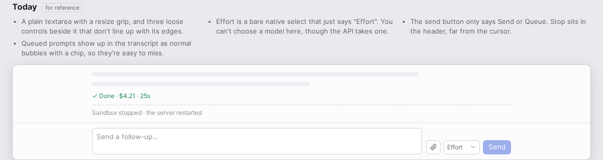
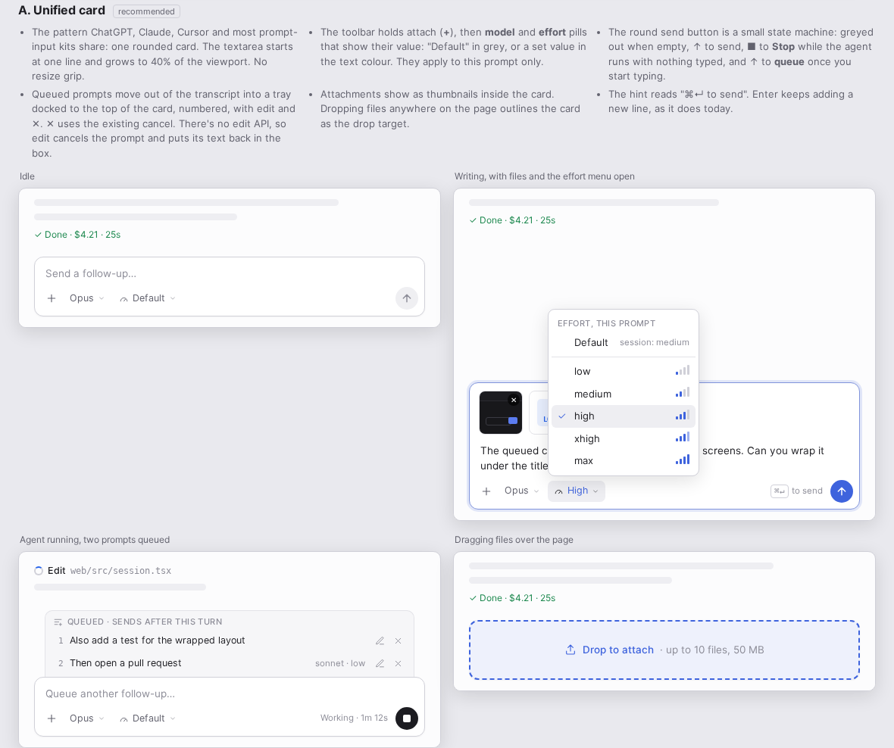
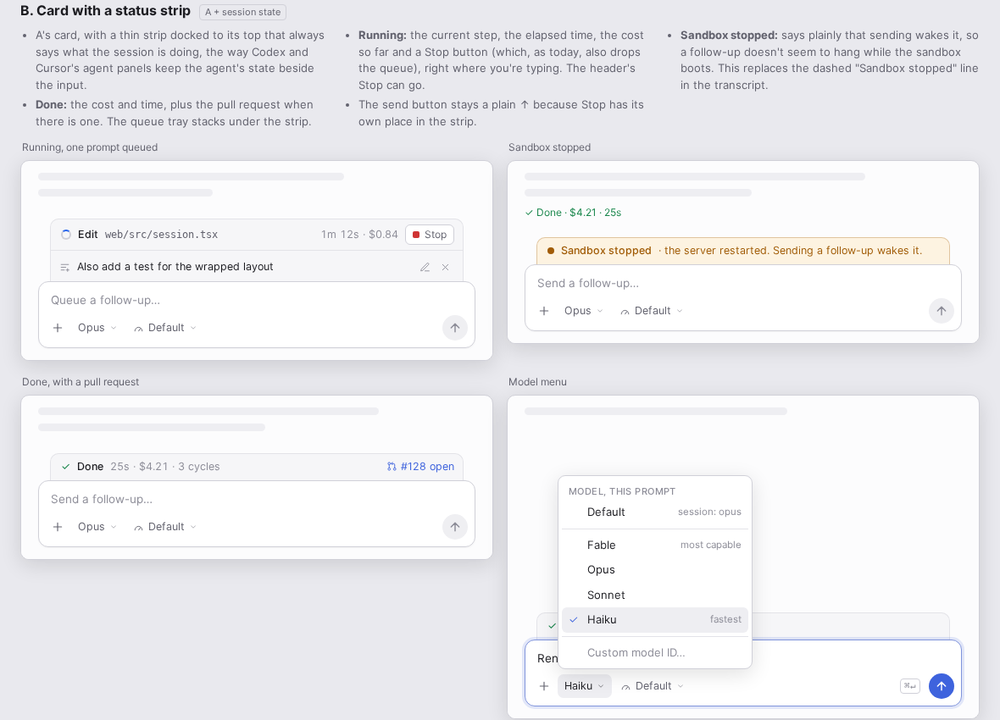
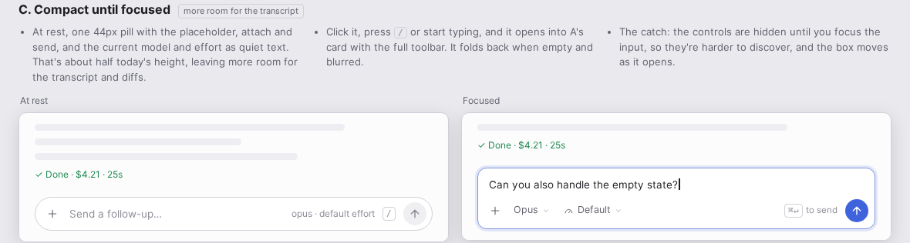
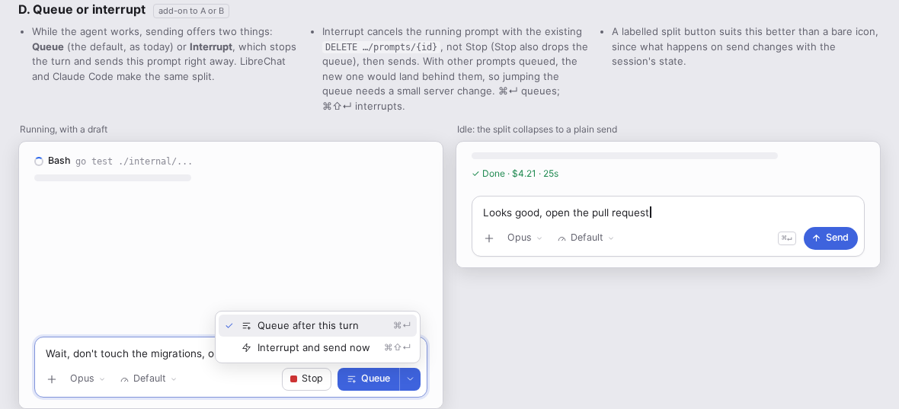

# Session input redesign mockups

Static mockups of four directions for the follow-up box at the bottom of a session (`Composer` in
`web/src/session.tsx`), drawn with the app's own design tokens. Open `index.html` in a browser for the notes on each,
the research behind them and a dark theme toggle; `png/` has screenshots of each one in light and dark.

| | |
|---|---|
| Today |  |
| A. Unified card: toolbar pills for model and effort, send/stop button, queue tray |  |
| B. A with a status strip: step, time, Stop, sandbox and PR state beside the input |  |
| C. Compact pill until focused |  |
| D. Queue or interrupt while the agent runs |  |
