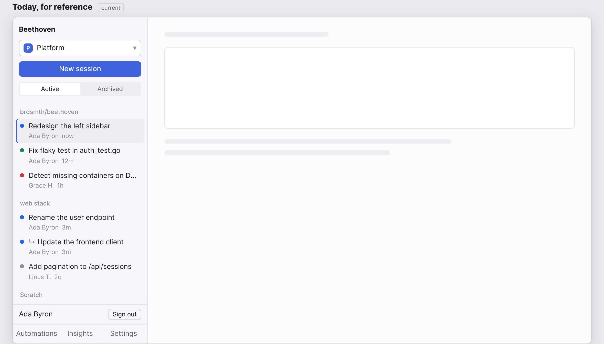
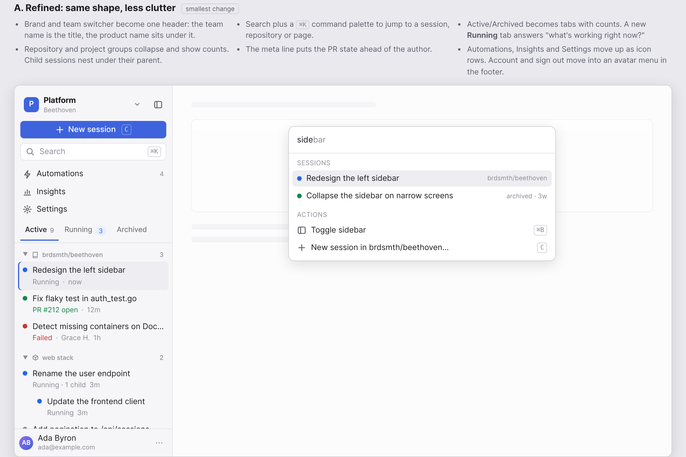
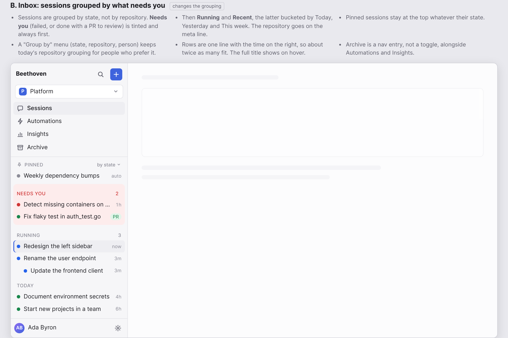
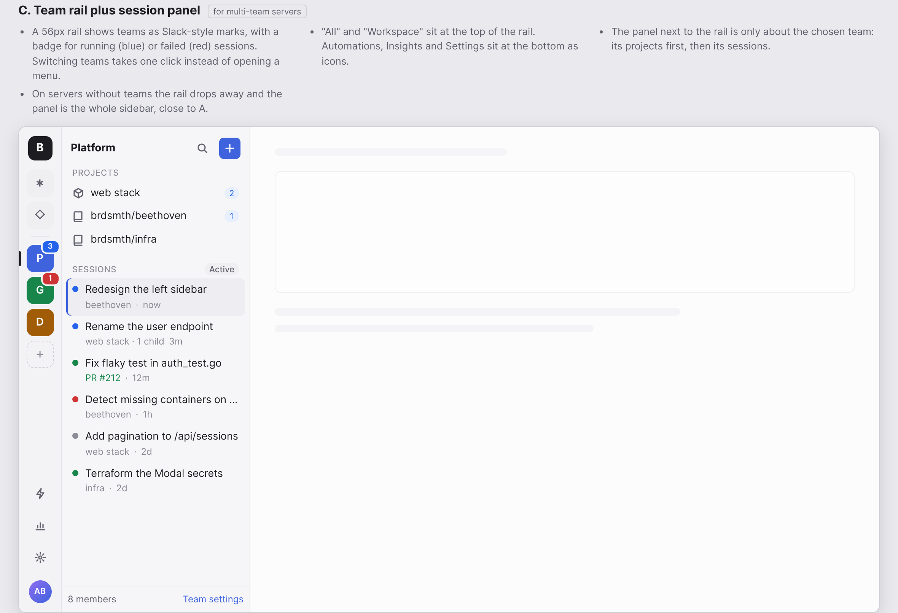
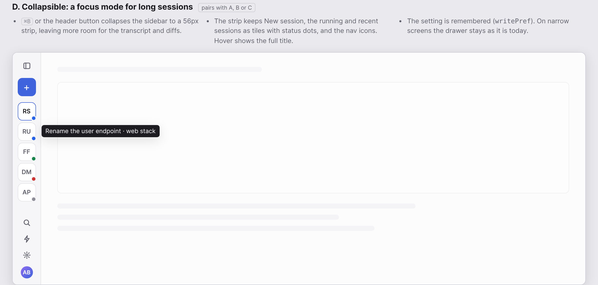

# Sidebar redesign mockups

Static mockups of four directions for the web UI's left sidebar (`Sidebar` in `web/src/main.tsx`), drawn
with the app's own design tokens. Open `index.html` in a browser for the notes on each and a dark theme
toggle; `png/` has screenshots of each one in light and dark.

| | |
|---|---|
| Today |  |
| A. Refined: search, ⌘K palette, tabs with counts, nav moved up |  |
| B. Inbox: grouped by what needs you, one-line rows |  |
| C. Team rail plus session panel |  |
| D. Collapsible focus mode |  |
